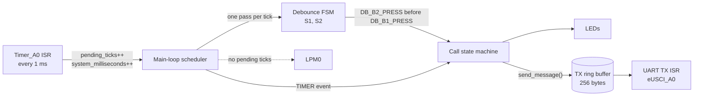
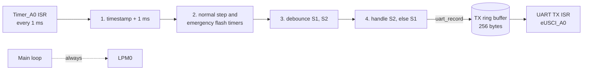
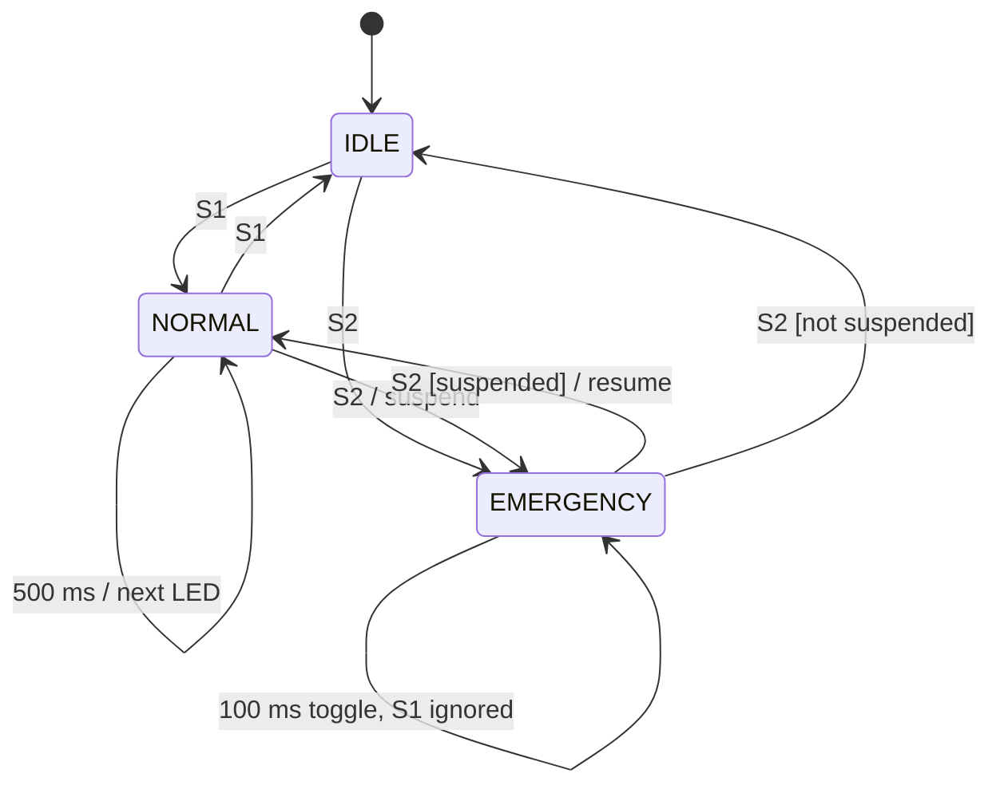
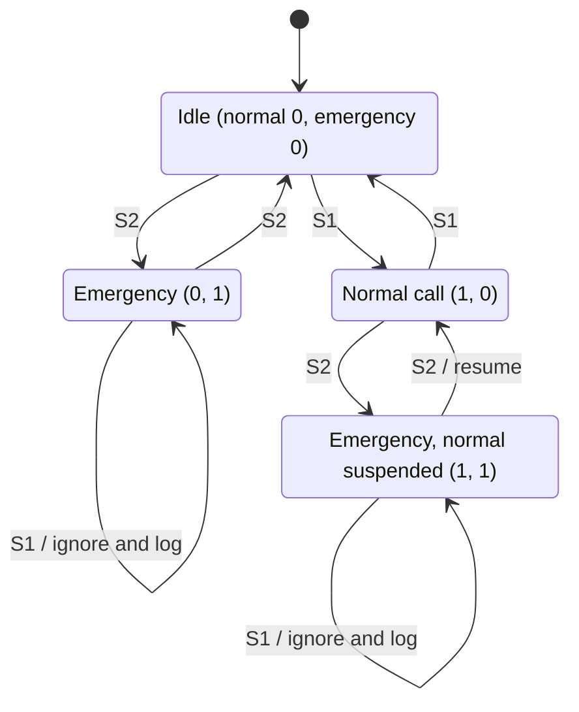
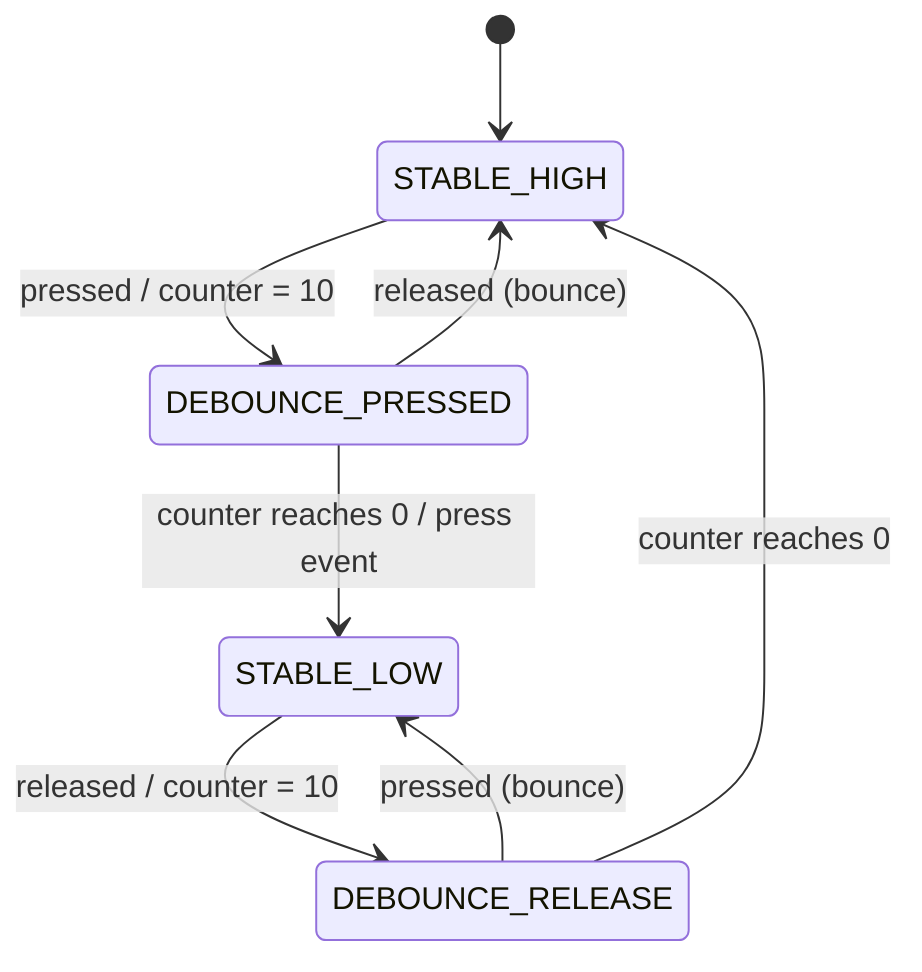

# MSP430 Hospital Call System

Interrupt-driven nurse-call controller for the TI MSP-EXP430FR5739, implemented twice: once in C and once in MSP430 assembly. Two push-buttons raise normal and emergency calls, LEDs show call status, and every state change is logged over UART with a millisecond timestamp.

<p align="center">
  
</p>

## What it does

| Call | Button | Indication |
|---|---|---|
| Normal | S1 starts, S1 again completes | One LED steps through LED1 → LED4 every 500 ms |
| Emergency | S2 starts, S2 again acknowledges | LED5–LED8 flash together |

- **Emergencies take priority.** Raising an emergency during a normal call suspends that call. The lit LED and the time remaining in the current step are preserved, and the call continues from the same point once the emergency is acknowledged.
- **S1 is ignored during an emergency**, and the ignored press is logged.
- **Simultaneous presses** validated in the same 1 ms tick are resolved in favour of S2.
- **Idle** returns all call LEDs to off, and the CPU sleeps in LPM0 between interrupts.
- **Every state change** is reported over UART at 9600 baud, 8N1, in the form `[nnnnnn ms] <event>`.

## Two implementations

The same behaviour is built on two different software architectures. The comparison is the most interesting part of the project.

| | C | Assembly |
|---|---|---|
| Where the work happens | Timer ISR only counts ticks; a main-loop scheduler runs debouncing and the state machine | All timing, debouncing, state changes and record generation run inside the Timer_A0 ISR; the main loop only re-enters LPM0 |
| CPU clock (MCLK) | DCO / 8 = 1 MHz | DCO = 8 MHz |
| Timer tick | 1 ms (SMCLK 1 MHz, CCR0 = 999) | 1 ms (SMCLK / 8 = 125 kHz, CCR0 = 124) |
| Button inputs | Internal pull-ups enabled | Inputs only; internal pull-ups not enabled |
| Debounce | Four-state FSM per button, 10 ticks | Up/down sample counters per button, 20 ms |
| Normal LED step | 500 ms | 500 ms |
| Emergency toggle | 100 ms | 200 ms |
| Task state | Explicit `IDLE` / `NORMAL` / `EMERGENCY` state plus a `normal_suspend` flag | Two flags, `normal` and `emergency`; both set means a normal call is suspended |
| UART producer | `send_message()` in the main loop | `uart_record` inside the timer ISR |
| Full TX buffer | Producer sleeps in LPM0 until the TX ISR frees space | Character is dropped (waiting inside an ISR would deadlock) |
| Ring-buffer wrap | Bit mask | Compare against buffer size |
| TX interrupt source | `UCA0IV` | `UCTXIFG` in `UCA0IFG` |
| Timestamp to decimal | `%` and `/` on the 32-bit millisecond count, at least 5 digits | Repeated subtraction of 32-bit powers of ten (the MSP430 has no divide instruction), at least 6 digits |
| Record format | `[ 04215 ms ] -> <event>` | `[004215 ms] <event>` |

The C structure is easier to extend, because a new task becomes a new event and handler. The assembly structure is more compact, but every new task makes the timer ISR longer.

## Architecture

### C version



### Assembly version



Detailed flowcharts for each ISR and the decimal conversion are in [`docs/design.md`](docs/design.md).

### Call state machine (C)



### Call states (assembly)



No separate suspend flag is needed. With both flags set, the normal step counter is skipped, so the lit LED stays on and the elapsed step time is kept until the emergency clears.

### Debounce state machine (C, per button)



A button must be released and validated before it can generate another event, so holding a button down produces exactly one press.

## Hardware

**Board:** MSP-EXP430FR5739 Experimenter Board, connected over USB. The UART log appears on the board's application UART virtual COM port.

| Signal | Pin | Configuration |
|---|---|---|
| LED1–LED4 | PJ.0–PJ.3 | Output, active high (normal call) |
| LED5–LED8 | P3.4–P3.7 | Output, active high (emergency, switched together) |
| S1 | P4.0 | Input, active low (normal call) |
| S2 | P4.1 | Input, active low (emergency call) |
| UART TX | P2.0 / UCA0TXD | eUSCI_A0 |
| UART RX | P2.1 / UCA0RXD | eUSCI_A0, configured but unused |

**Shared configuration**

| Item | Setting |
|---|---|
| DCO | 8 MHz (`DCOFSEL_3`) |
| SMCLK | DCO / 8 = 1 MHz |
| UART | 9600 baud, 8N1, BRCLK = SMCLK |
| Baud registers | `UCA0BRW = 6`, `UCA0MCTLW = 0x2081` (UCOS16 = 1, UCBRF = 8, UCBRS = 0x20) |
| Interrupts | Timer_A0 CCR0, eUSCI_A0 TX (enabled only while data is queued); RX interrupt off |
| Low power | LPM0 between events |

At 9600 baud one character takes about 1.04 ms. The TX interrupt is switched off whenever the buffer empties: `UCTXIFG` stays set while the transmitter is idle, so leaving `UCTXIE` on would keep the CPU awake.

## Example UART output

Assembly version. The sequence starts a normal call, raises an emergency that suspends it, tries S1 during the emergency, then acknowledges the emergency and completes the call. Timestamps are illustrative.

```
[000000 ms] SYSTEM READY; IDLE
[004215 ms] S1 -> NORMAL CALL START; LED = 1
[004715 ms] NORMAL CALL PROGRESS; LED = 2
[005215 ms] NORMAL CALL PROGRESS; LED = 3
[005395 ms] S2 -> EMERGENCY CALL START; NORMAL CALL SUSPEND
[006930 ms] S1 IGNORED: EMERGENCY CALL ACTIVE
[008104 ms] S2 -> EMERGENCY CALL COMPLETE; NORMAL CALL RESUME
[008424 ms] NORMAL CALL PROGRESS; LED = 4
[009120 ms] S1 -> NORMAL CALL COMPLETE; ENTER IDLE
```

The log alone shows that the step time was preserved. The call had run 180 ms of its step when it was suspended (5215 → 5395). It needed the remaining 320 ms after resuming (8104 → 8424), giving 180 + 320 = 500 ms.

The C version logs the same events with its own record format:

```
[ 00000 ms ] -> SYSTEM READY; IDLE
[ 04210 ms ] -> S1 -> NORMAL CALL START; LED = 1
[ 04709 ms ] -> NORMAL CALL PROGRESS; LED = 2
[ 05209 ms ] -> NORMAL CALL PROGRESS; LED = 3
```

## Building and running

1. Install [Code Composer Studio](https://www.ti.com/tool/CCSTUDIO).
2. Build each version as its own CCS project targeting the **MSP430FR5739**:
   - **C:** `firmware/c/` is a complete CCS project. Import that folder as an existing project, then build. It was created from TI's driverlib empty-project template, but the code uses direct register access only, so driverlib is not included.
   - **Assembly:** create an empty assembly-only CCS project for the MSP430FR5739 and add `firmware/assembly/hospital_call.asm`.
3. Connect the board over USB, then build and debug to program it.
4. Open a serial terminal on the board's application UART COM port at **9600 baud, 8N1**.
5. Press S1 for a normal call and S2 for an emergency.

## Testing

Both builds were run through the same sequence on hardware:

| Step | Action | Expected result |
|---|---|---|
| 1 | Reset | All LEDs off; `SYSTEM READY; IDLE` |
| 2 | S1 | LED1 on; normal call start record |
| 3 | Wait ~2.5 s | LED advances every 500 ms and wraps from LED4 to LED1; one progress record per step |
| 4 | S2 | LED5–LED8 flash; normal LED frozen; emergency start with suspend record |
| 5 | S1 | No change; S1 ignored record |
| 6 | S2 | Flashing stops; normal call resumes from the frozen LED; resume record |
| 7 | S1 | All LEDs off; normal call complete record |
| 8 | S2 twice from idle | Emergency starts, then returns to idle |
| 9 | S1 and S2 together | Emergency only |

Step-time preservation in step 6 is checked from the timestamps, as in the example above.

## Limitations and next steps

- **Fixed 1 ms wake-up.** The CPU wakes 1000 times a second even when idle. Running Timer_A0 from ACLK in LPM3 would cut idle current, at the cost of restoring SMCLK before each transmission.
- **ISR-generated records (assembly).** Formatting records inside the timer ISR makes its run time depend on the events in each tick, and characters are dropped silently if the buffer fills.
- **Timestamp accuracy.** Time is derived from the DCO and drifts with its tolerance. The board's 32.768 kHz crystal would be a better reference.
- **Mismatched log formats.** The two versions word their records differently, which makes terminal captures harder to compare directly.
- **No receive path.** The system can't be queried or reset from the terminal.

## Repository structure

```
.
├── firmware/
│   ├── c/                      C implementation (CCS project)
│   │   ├── main_1.c            Initialisation and main-loop scheduler
│   │   ├── Drivers/
│   │   │   ├── Pin_Assignment.h  LED and button pins, LED helpers
│   │   │   ├── timer.c/.h        Clock setup, Timer_A0 1 ms ISR, tick counter
│   │   │   └── uart.c/.h         eUSCI_A0 setup, TX ring buffer and ISR
│   │   └── FSM/
│   │       ├── debounce.c/.h     Four-state debounce FSM per button
│   │       └── state_machine.c/.h  Call state machine and timestamped log
│   └── assembly/
│       └── hospital_call.asm   Complete assembly implementation (single file)
└── docs/
    ├── design.md     ISR and conversion flowcharts
    ├── demo.gif      Board running the firmware
    └── board.jpg     Experimenter board
```

## Team

Built for **CMPE2003 Microcomputers** at Curtin University, 2026.

| Member | Contribution |
|---|---|
| **Om Patel** | Assembly UART and interrupt code: interrupt-driven transmit ring buffer, UART TX ISR and timestamped record formatting. UART flowcharts, hardware testing and demonstration. |
| **Mohamed Khalif** | Assembly implementation: Timer_A0 ISR, button debouncing and call-state logic. |
| **Pravit (Mac) Mung-Uaklang** | C Code |

## Academic integrity

Shared as a portfolio project after assessment, with the unit coordinator's permission. If you are taking this unit, do not submit any part of this work as your own.
