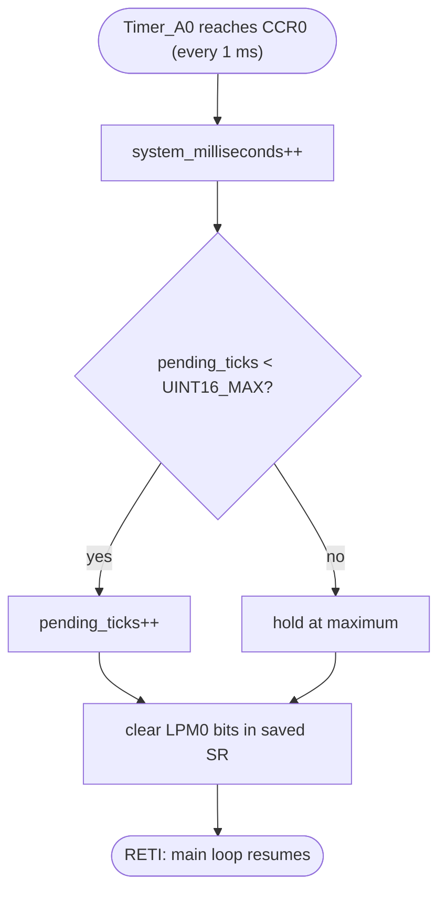
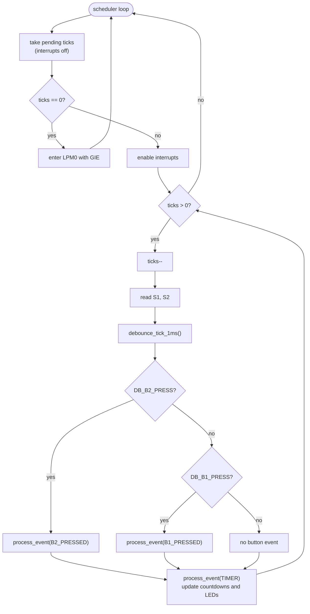
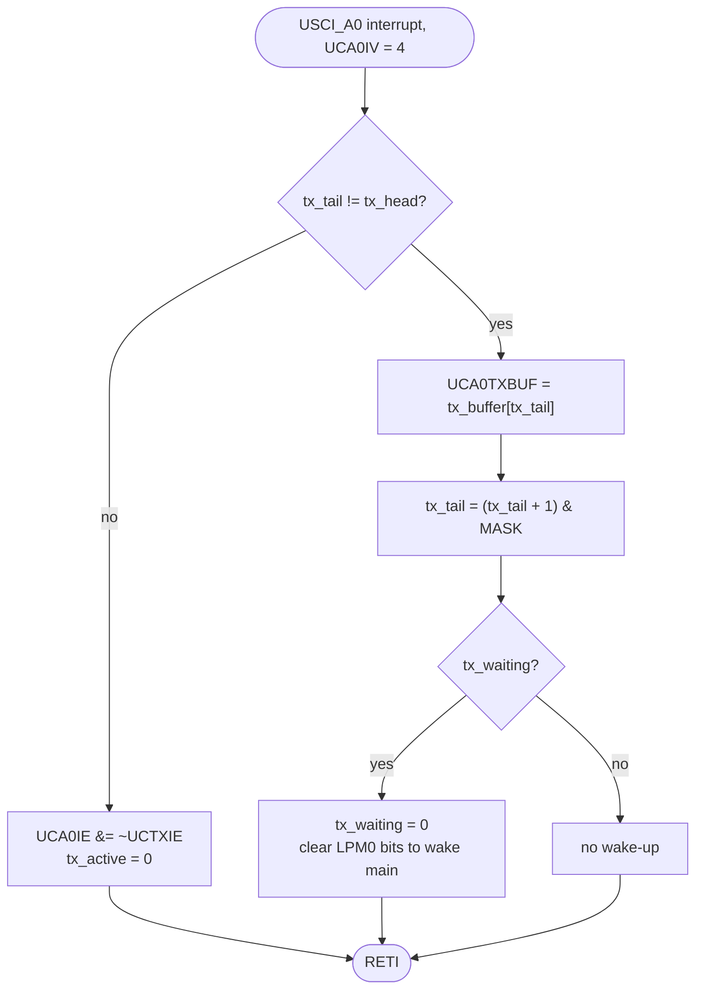
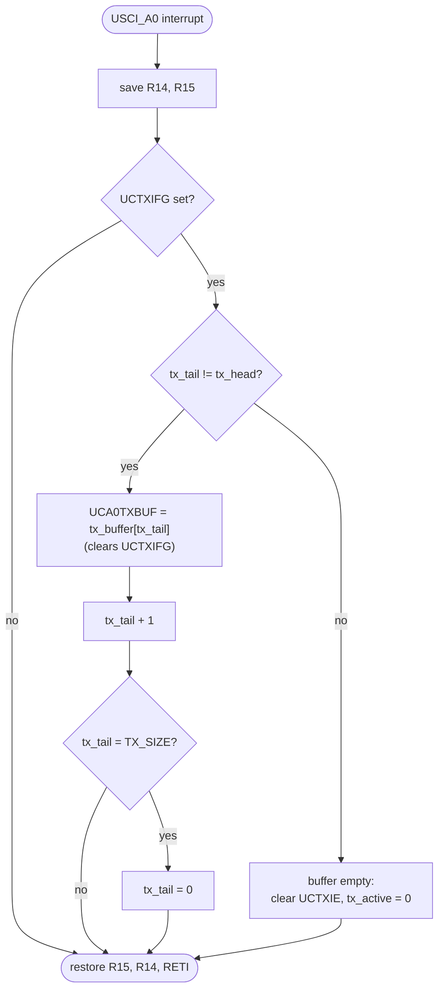
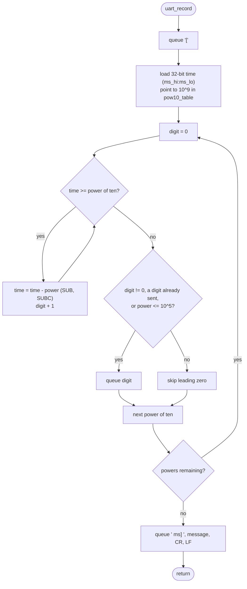

# Design details

Flowcharts for the interrupt service routines, the C scheduler and the assembly timestamp conversion. GitHub renders these diagrams directly.

## C: Timer_A0 ISR

The ISR does a small, fixed amount of work and leaves all processing to the main loop.

## C: main-loop scheduler

## C: UART TX ISR

When the buffer is full, `send_message()` sets `tx_waiting` and sleeps in LPM0. The ISR wakes it as soon as one slot is free.

## Assembly: UART TX ISR

R14 and R15 are the only registers this ISR modifies, so they are the only ones saved. The enqueue routine runs only inside the timer ISR (or before GIE is set), so this ISR can never interrupt a buffer update, and no extra interrupt masking is needed.

## Assembly: timestamped record

Each record is queued as `[nnnnnn ms] <message>` followed by CR LF. The MSP430 has no divide instruction, so the 32-bit millisecond count is converted to decimal by repeated subtraction.

Leading zeros above 10^5 are suppressed, so at least six digits are always printed. The count is advanced every tick with `ADD` and `ADDC`. It widens to seven digits after 999 999 ms (about 16.7 minutes) and wraps after about 49.7 days.

## Timing and power notes

- **Interrupt latency (assembly).** Each record takes roughly 0.5 ms to format at 8 MHz. A tick that produces two records can therefore overrun the 1 ms period. The CCR0 flag stays pending in that case, so the next tick is serviced late rather than lost, and the timestamp stays correct.
- **TX buffer sizing (assembly).** The longest record is 63 characters, and the largest single-tick burst (a progress record plus an emergency-start record) is about 104. The link drains about 960 characters per second, so the 255 usable slots make dropped characters unlikely.
- **Idle cost.** An idle tick of the assembly ISR is about 130 cycles, roughly 17 µs at 8 MHz, so the CPU is active for under 2 % of each 1 ms period.
